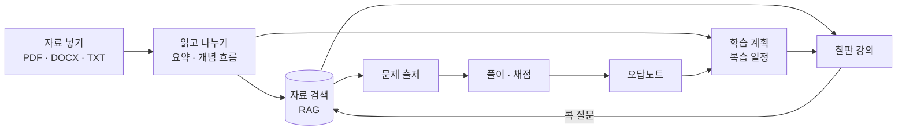
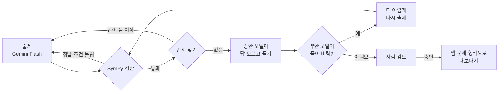

# Proofy

**자료를 넣으면, 강의가 되고 문제가 됩니다.**

교재, 수업 PDF, 필기. 쌓아만 둔 자료로 칠판 강의를 하고 문제를 만들어 주는 AI 과외 선생님.

| 이런 순간 | Proofy |
|---|---|
| 자료는 쌓였는데 어디서부터 볼지 모르겠음 | 넣은 자료를 개념 흐름대로 나누고, 오늘 볼 분량부터 |
| 교재 봐도 모르겠던 그 한 줄 | 칠판 강의 중에 그 줄을 콕 눌러 질문. 칠판이 그 자리에서 다시 풀어 줌 |
| 이 부분 문제가 더 있었으면 | 그 자료에서 문제를 만듦. 수학은 SymPy로 정답을 검산한 것만 |
| 답은 맞았는데 풀이가 불안함 | 단계마다 채점. 틀리면 어느 단계에서 왜 틀렸는지 |
| 같은 데서 또 틀림 | 오답노트로, 며칠 뒤 계획에 다시 |

```
미분계수의 정의 활용

lim (x→2) {f(x) − 3} / (x − 2) = 5   ⇒  f(2) = 3, f′(2) = 5
g(x) = x²f(x) 로 두면 g(2) = 12
lim (x→2) {x²f(x) − 12} / (x − 2) = g′(2)        ← 콕
= 2·2·f(2) + 2²·f′(2) = 32

Q. 왜 갑자기 g′(2)가 돼요?
A. 분자가 g(x) − g(2) 꼴이라서요. 미분계수 정의 그대로예요.
```

자료가 없어도 바로 써 볼 수 있게 수능 수학 7과목 22단원(2022 개정 교육과정)이 기본 자료로 들어 있습니다.

---

## 자료가 강의와 문제가 되기까지



| 단계 | 맡는 곳 | 지금 |
|---|---|---|
| 자료 넣기, 읽고 나누기 | `study_agent/document_agent` | 핵심 요약, 개념 흐름 순서의 설명, 확인 문제, 원문 페이지 표시, 원문 근거 검사까지 구현. 따로 실행되고 Proofy 화면(`/documents`)과 LLM 키에는 아직 연결 전 |
| 자료 검색(RAG) | `study_agent/rag_server` | 임베딩 `bge-m3`, 재정렬 `bge-reranker-v2-m3`. 따로 실행되고 Proofy와 연결 전 |
| 학습 계획 | Proofy `planner`, `study_agent/roadmap_agent` | Proofy 계획은 기본 자료로 동작. 넣은 자료로 계획과 복습 일정을 짜는 roadmap_agent는 연결 전 |
| 칠판 강의 | Proofy 강의 플레이어 | 기본 자료로 동작(장면 1,002개). 넣은 자료로 칠판 장면을 만드는 부분은 아직 |
| 강의 중 질문 | Proofy, `study_agent/tutor_agent` | Proofy는 칠판에 풀이 장면을 끼워 답함. 자료 원문을 근거로 답하는 tutor_agent는 연결 전 |
| 문제 출제 | `study_agent/problem_agent`, Proofy 고난도 파이프라인 | problem_agent는 자료 조각으로 객관식·주관식·OX·빈칸 등을 만들고 품질 검사(연결 전). 고난도 파이프라인(아래)은 동작하지만 지금은 단원별 출제 틀로 출제하고, 자료 조각을 입력으로 받는 부분은 아직 |
| 풀이 · 채점 · 오답노트 | Proofy | 동작. 수학은 단계별 SymPy 채점 |

---

## 고난도 문제는 이렇게 만듭니다

자료에서 쉬운 문제를 뽑기는 쉽습니다. 어려운 문제는 틀리기 쉽습니다. 목표는 수능 22번 수준이고, LLM이 낸 문제를 그대로 학생 앞에 두지 않습니다.



| 단계 | 하는 일 |
|---|---|
| 출제 | 한 번에 한 문제. 단원별 출제 틀(미적분Ⅰ 미분 7개, 적분 4개)을 돌아가며 지정. 함수를 직접 주지 않고 조건 (가)(나) 뒤에 숨김. 정답은 1~999 자연수. |
| SymPy 검산 | 모델이 조건마다 확인 식을 같이 써 오면, 허용된 함수만 쓰는 격리된 프로세스에서 실행해 조건과 정답을 확인. 틀리면 이유를 붙여 고쳐 오게 함. |
| 반례 찾기 | 다른 모델이 출제자가 놓친 경우를 찾음. 반례가 나오면 SymPy가 원래 조건에 넣어 보고, 답이 둘이면 돌려보냄. |
| 강한 모델 풀이 | `gpt-oss-120b`가 답을 모른 채 풀어서 정답을 맞히는지. 다르면 다른 모델에게 한 번 더. |
| 약한 모델 풀이 | `gpt-oss-20b`가 풀어 버리면 22번감이 아님. 같은 틀로 더 어렵게 다시 출제(최대 2번). |
| 사람 검토 | 풀이, 케이스, 검산 결과, 풀이 모델 기록을 보고 승인. 승인한 문제만 앱 문제 형식으로 나감. |

### 왜 사람이 마지막에 보나

첫 실행에서 Gemini가 낸 문제입니다.

> 최고차항의 계수가 1인 삼차함수 f(x)와 실수 k에 대하여 g(x) = (x − 1)|f(x) − k| 라 하자.
> (가) 함수 g(x)는 실수 전체의 집합에서 미분가능하다.
> (나) 함수 g(x)의 극댓값은 0이고, 극솟값은 −16이다.
> (다) f(0) = 2
>
> f(4)의 값을 구하시오.

출제자 답은 158입니다(f(x) − k = (x − 1)(x + 3)²). 그런데 f(x) − k = (x − t)³, t = 1 − 8·3^(1/4)/3 도 세 조건을 모두 만족하고, 이때 f(4) ≈ 262.03입니다. 풀이가 삼중근을 x = 1일 때만 따졌습니다.

이 문제는 SymPy 검산을 통과했고, 다른 풀이 모델도 158을 냈습니다. 22번 수준에서 문제가 망가지는 곳은 대개 정답 계산이 아니라 빠뜨린 경우 하나입니다. 이 문제는 지금 반례 찾기 단계의 테스트로 남아 있습니다.

---

## 아직 남은 것

| 영역 | 상태 |
|---|---|
| 자료 연결 | 업로드, 검색, 자료 기반 질문, 자료 기반 문제, 계획이 `study_agent`에 따로 있음. Proofy 화면과 API에 붙이는 것이 다음 큰 작업. |
| 고난도 문제 | 무료 Gemini Flash로 맞는 4점 문제(20~21번급)까지 확인. 22번 수준과 "답이 하나인지" 자동 확정은 아직이라 사람 검토가 마지막 관문. |
| 기본 문제 은행 | 22단원 924문항. 대부분 숫자만 바꾸는 템플릿이라 2~3점 수준. |
| 계정 | 데모용 인증. 공개 배포 전에 토큰 인증과 관리자 기능 잠금이 필요. 로그인도 Proofy 자체 방식과 `study_agent`의 Supabase 중 하나로 정리해야 함. |

---

## 바로 실행

```bash
./scripts/bootstrap.sh    # 가상환경, 패키지, .env 생성
./scripts/start-all.sh    # Proofy API와 화면을 함께 띄움
```

- 화면: http://localhost:3000
- API 문서: http://localhost:8000/docs
- 끄기: `./scripts/stop-all.sh`

LLM 키가 없어도 실행됩니다. 강의 중 질문에는 내장 답변이 나가고, 문제 출제만 키가 필요합니다.

### 자료 쪽 서버 (선택)

`apps/study_agent`의 서버는 Proofy와 따로 띄웁니다. 각 폴더의 `requirements.txt`로 가상환경을 만든 뒤:

```bash
# 자료 검색(RAG) 서버, 8001번
cd apps/study_agent/rag_server
API_PORT=8001 TUNNEL_BACKEND=none OCR_PROVIDER=none .venv/bin/python server.py

# 자료·계획·문제·튜터 에이전트를 묶은 main_server, 8010번 (기본값 8000은 Proofy API와 겹침)
cd apps/study_agent/main_server
set -a && . ../problem_agent/.env.free.example && set +a
API_PORT=8010 RAG_SERVER_URL=http://127.0.0.1:8001 RAG_AGENT_URL=http://127.0.0.1:8001 \
  SEARCH_AGENT_URL=http://127.0.0.1:8001 DEMO_SEARCH_ENABLED=false \
  DATABASE_URL=sqlite+pysqlite:///./study_agent_free.db .venv/bin/python server.py
```

위 설정은 LLM 키 없이 도는 구성이라, 튜터와 문제 생성은 대체 로직으로만 답합니다. 상태는 `http://127.0.0.1:8010/api/agents/status`에서 확인합니다.

에이전트별 설정은 [`apps/study_agent/README.md`](apps/study_agent/README.md)와 각 에이전트 폴더의 문서를 참고하세요.

### LLM 설정

키는 루트 `.env`에만 넣습니다(`.env.example` 참고).

| 쓰는 곳 | 모델 |
|---|---|
| 강의 중 질문, 계획 전략 | Gemini(`APP_GEMINI_MODEL`). 실패하면 Groq `openai/gpt-oss-120b`가 대신 답하고 5분 동안 Gemini를 건너뜀 |
| 고난도 문제 출제 | Gemini Flash. `--model`로 바꾸거나 예비 모델을 줄 수 있음 |
| 반례 찾기, 풀이 | Groq `openai/gpt-oss-120b`(강한 모델), `openai/gpt-oss-20b`(약한 모델) |

### 고난도 문제 출제

`apps/api`에서 실행합니다. 스크립트가 루트 `.env`를 직접 읽습니다. 한 문제에 5~15분 걸립니다.

```bash
.venv/bin/python -m scripts.generate_problems generate --unit calc1-diff --count 3
.venv/bin/python -m scripts.generate_problems list                # 상태, 난이도 판정, 검토 상태
.venv/bin/python -m scripts.generate_problems show <id>           # 문제, 풀이, 케이스, 검산, 풀이 모델 기록
.venv/bin/python -m scripts.generate_problems review <id> --approve   # 또는 --reject --note "이유"
.venv/bin/python -m scripts.generate_problems export              # 승인한 문제를 앱 문제 형식으로
.venv/bin/python -m scripts.generate_problems solve --file p.txt --answer 13   # 기출 등으로 난이도 신호 맞춰 보기
```

출제한 문제는 `apps/api/data/generated/problems/<단원>/`에, 내보낸 문제는 `apps/api/data/generated/approved/`에 쌓입니다.

---

## 개발

| 경로 | 내용 |
|---|---|
| `apps/web` | Next.js 15, React 18, TypeScript. 화면 전체와 `MathText` 수식 표시 |
| `apps/api` | FastAPI. 계획, 칠판 강의 세션, 채점, 오답노트, 고난도 문제 출제 |
| `apps/api/app/services/problem_factory.py` | 고난도 문제 출제 파이프라인 |
| `apps/api/app/domain/problem_verifier.py` | LLM이 쓴 조건 검사식을 격리해서 SymPy로 실행 |
| `apps/api/app/domain/evaluator.py` | 학생 풀이 단계별 SymPy 채점 |
| `apps/api/app/content` | 기본 자료(커리큘럼·강의·문제) 생성기, 출제 틀 |
| `apps/study_agent` | 자료 업로드·요약(document), 검색(rag), 계획(roadmap), 문제(problem), 튜터(tutor) 에이전트와 묶음 서버(main_server) |

테스트 (71개, 3분쯤):

```bash
PYTHONPATH=apps/api apps/api/.venv/bin/python -m unittest \
  apps/api/tests/test_evaluator.py apps/api/tests/test_content_selection.py \
  apps/api/tests/test_p1_service.py apps/api/tests/test_curriculum_review.py \
  apps/api/tests/test_lecture_copy.py apps/api/tests/test_problem_verifier.py \
  apps/api/tests/test_problem_factory.py
```

화면 타입 검사와 빌드:

```bash
cd apps/web && node_modules/.bin/tsc --noEmit -p . && npm run build
```

PostgreSQL까지 함께 띄우려면 `docker compose up --build`. 기본은 메모리 저장소(`APP_STORAGE_BACKEND=memory`)입니다.
